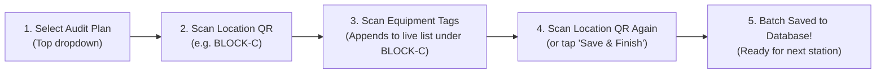

# 🏢 Assets Management & Auditing System

Enterprise-grade asset lifecycle management and auditing platform built with a **Turborepo monorepo**.

## 📦 Stack

| Layer | Technology |
|-------|-----------|
| Monorepo | Turborepo + npm workspaces |
| Backend | NestJS + Prisma ORM |
| Database | Microsoft SQL Server (MSSQL) |
| Frontend | Next.js 14 (App Router) + Tailwind CSS + Shadcn UI |
| Mobile Architecture | Mobile-First Progressive Web App (PWA) |
| Auth | JWT (access + refresh tokens) |
| Validation | class-validator + Zod (shared) |
| Docs | Swagger (auto-generated) |

## 🗂️ Structure

```
assets-management/
├── apps/
│   ├── api/                  # NestJS backend (port 3001)
│   │   └── src/
│   │       ├── assets/       # Asset lifecycle & SAP code lookup
│   │       ├── locations/    # Company > Unit > Block > Line hierarchy
│   │       ├── audits/       # Plans, sessions & discrepancy resolution
│   │       ├── assignments/  # User/Department custody tracking
│   │       ├── maintenance/  # Preventive & corrective records
│   │       ├── transfers/    # Inter-department asset transfers
│   │       └── vendors/      # Supplier & service management
│   │
│   └── web/                  # Next.js 14 App Router PWA (port 3000)
│       └── src/
│           ├── app/          # App Router routes (mobile-first)
│           │   ├── page.tsx          # Operations Dashboard & KPIs
│           │   ├── layout.tsx        # Responsive layout + PWA safe area insets
│           │   ├── loading.tsx       # Shimmer skeleton loader
│           │   ├── error.tsx         # Error boundary with retry
│           │   ├── not-found.tsx     # 404 handler
│           │   ├── manifest.ts       # App Router native Web App Manifest
│           │   ├── api/[...path]/    # App Router API Route proxy to NestJS
│           │   ├── assets/           # Inventory catalog & filters
│           │   │   ├── [id]/         # Dynamic asset detail & QR tag
│           │   │   └── new/          # Equipment registration form
│           │   ├── locations/        # Interactive 4-level tree explorer
│           │   ├── scan/             # Camera QR/barcode scanner & auditor
│           │   └── audits/           # Audit sessions & progress tracker
│           ├── components/
│           │   ├── navigation/       # MobileBottomNav, TopNavbar, DesktopSidebar
│           │   └── ui/               # Shadcn UI primitives (Button, Card, Badge, Input)
│           └── lib/utils.ts          # Tailwind cn() merge helper
│
├── packages/
│   ├── database/             # Prisma schema + MSSQL client
│   ├── types/                # Shared TypeScript enums & interfaces
│   └── validators/           # Shared Zod schemas (FE + BE)
├── turbo.json
├── pnpm-workspace.yaml
└── .env
```

## 🚀 Getting Started

👉 **Production IIS Hosting Guide**: See complete step-by-step instructions in [`docs/IIS_CONFIG.md`](docs/IIS_CONFIG.md).

### One-Command Standalone Production Build (Zero Server NPM Install)
```bash
npm run package:standalone
# Creates deploy-iis.zip (132 MB) containing self-contained Web, API, and Windows Prisma engine.
```

### Prerequisites
- Node.js 20+
- npm 10+
- Microsoft SQL Server (local, Docker, or Azure)

### 1. Install dependencies
```bash
npm install
```

### 2. Configure environment
```bash
cp .env.example .env
# Edit .env with your MSSQL connection string
```

### 3. Generate Prisma client & push schema
```bash
npm run db:generate
npm run db:push
```

### 4. Bulk import Excel assets (13,470 records)
```bash
npm run db:import-excel
```

### 5. Start development servers
```bash
npm run dev
# API:  http://localhost:3001/api/v1
# Web:  http://localhost:3000
# Docs: http://localhost:3001/api/docs
```

## 📱 Frontend App Router & Mobile-First PWA

The frontend (`apps/web`) is built with the **Next.js 14 App Router** using mobile-first ergonomics and touch-optimized navigation:

### App Router Routes

| Route | Type | Description |
|-------|------|-------------|
| `/` | Static | Operations Dashboard with KPI cards, quick actions, and recent equipment |
| `/assets` | Static | Asset catalog with search across Name, `assetCode`, and `sapAssetCode` |
| `/assets/import` | Static | Drag-and-drop Excel workbook bulk importer with mapping preview & stats |
| `/assets/[id]` | Dynamic | Detailed asset inspection, specifications, financial depreciation & QR tags |
| `/assets/new` | Static | Equipment registration with cascading Company &rarr; Line location picker |
| `/locations` | Static | Interactive 4-level tree explorer with expandable nodes and asset counters |
| `/scan` | Static | Full-screen camera QR & barcode scanner viewfinder + condition logging |
| `/audits` | Static | Audit sessions, physical verification progress & discrepancy tracking |
| `/api/[...path]` | Dynamic | App Router Route Handler proxying API calls to the NestJS backend |
| `/manifest.webmanifest`| Dynamic | App Router native Web App Manifest route generated via `manifest.ts` |

### Mobile-First PWA Design Patterns
- **Touch-Friendly Navigation**: Fixed mobile bottom navigation bar (`MobileBottomNav`) with a raised central action button for rapid physical scanning.
- **Safe Area Insets**: Responsive spacing adhering to iOS and Android safe zones (`env(safe-area-inset-top)` and `env(safe-area-inset-bottom)`).
- **Responsive Layout**: Fluid sidebar navigation on tablet/desktop viewports (`hidden md:flex`) and bottom bar on mobile devices.
- **Offline & PWA Ready**: Native manifest declaration, offline status indicator, standalone display mode, and instant touch feedback.

## 🏭 Location Hierarchy

Locations follow a strict 4-level enterprise manufacturing hierarchy:

```
Company (Root)
 └── Unit (Plant / Branch)
      └── Block (Building / Facility Section)
           └── Line (Production / Assembly Line)
```

- **Company**: Root entity representing the enterprise organization (`parentId = null`).
- **Unit**: Factory, manufacturing plant, or operating branch under a Company.
- **Block**: Specific building, workshop, or bay within a Unit.
- **Line**: The physical production, packaging, or operational line where assets are stationed.

### Location QR Placards & Auditing
Each location level (especially **Lines** and **Blocks**) possesses an auto-generated unique QR tag (`qrCode`):
- **Physical Placards**: Printable location QR placards posted on factory lines and workshop entrances.
- **Station Check-in**: Scanning a Location QR code via the PWA scanner immediately checks the auditor into that line, pulling the checklist of all expected assets stationed there for rapid verification.

Hierarchy integrity is enforced on creation and update: parent relations cannot skip or mismatch levels. `GET /api/v1/locations/tree` returns the full nested hierarchy, and `GET /api/v1/locations/code/:code` enables instant QR code lookup.

## 🔍 Floor Walk Audit Workflow

The mobile auditing workflow (`/scan` and `/audits`) uses an intuitive 4-step **Location-Bound Batching** cycle for rapid equipment inventory verification:



1. **Select Audit Plan**: Select the target audit plan from the dropdown at `/scan`.
2. **Scan Location QR**: Point camera at the station placard (e.g. `BLOCK-C`) to open the station.
3. **Scan Equipment Tags**: Rapidly scan tags stationed there; they append in real-time to the on-screen list with condition toggles (`Good`, `Fair`, `Damaged`) and relocation mismatch detection.
4. **Scan Location Again &rarr; Auto-Save**: Scan `BLOCK-C` a second time (or tap the commit button) to persist the batch directly to the database.

👉 **Full Guide**: See [`docs/AUDIT_WORKFLOW.md`](docs/AUDIT_WORKFLOW.md) for API payloads and sound chime reference.

## 🏷️ Asset Tracking & SAP Integration

Assets track dual identifying codes:
- **`assetCode`**: Internal sequence code generated automatically (e.g. `AST-2024-00001`).
- **`sapAssetCode`**: Unique SAP enterprise reference code for ERP synchronization and lookup.

Assets can be queried, filtered, and scanned via QR code, barcode, `assetCode`, or `sapAssetCode`.

## 📡 Backend API Endpoints

| Module | Endpoints |
|--------|-----------|
| **Auth** | POST `/api/v1/auth/login`, `/register`, `/refresh`, `/logout` · GET `/me` |
| **Locations** | GET/POST `/api/v1/locations` · GET `/locations/tree` · GET `/locations/code/:code` · GET/PUT/DELETE `/locations/:id` |
| **Assets** | GET/POST `/api/v1/assets` · GET/PUT/DELETE `/assets/:id` · PATCH `/assets/:id/status` · GET `/assets/code/:code` |
| **Assignments** | POST `/api/v1/assignments` · PATCH `/assignments/:id/return` · `/acknowledge` |
| **Transfers** | POST `/api/v1/transfers` · PATCH `/transfers/:id/approve` \| `/reject` \| `/complete` |
| **Vendors** | GET/POST `/api/v1/vendors` · GET/PUT/DELETE `/vendors/:id` |
| **Audits** | POST `/api/v1/audits/plans` · POST `/audits/plans/:id/commit-location` · POST `/audits/sessions` · PUT `/audits/sessions/:id/complete` \| `/reopen` · POST `/audits/sessions/:id/items` · DELETE `/audits/plans/:id` |
| **Maintenance** | POST `/api/v1/maintenance/schedules` · POST `/maintenance/records` |
| **Reports** | GET `/api/v1/reports/assets` · `/depreciation` · `/audits/:planId` (+ `/export` for Excel) |
| **Notifications**| GET `/api/v1/notifications` · PATCH `/notifications/read-all` |
| **Dashboard** | GET `/api/v1/dashboard/kpis` |

## 🗄️ Database

The Prisma schema is in `packages/database/prisma/schema.prisma` configured for **Microsoft SQL Server**.

```bash
# Push schema changes (dev)
npm run db:push

# Run migrations (production)
npm run db:migrate

# Open Prisma Studio
npm run db:studio
```

> **MSSQL Note**: Microsoft SQL Server connector does not support native Prisma enums (enum validation is maintained in `@repo/types` and `@repo/validators`), and multiple cascade paths are handled with explicit `NoAction` rules.

## 🔐 Roles

| Role | Level |
|------|-------|
| `SUPER_ADMIN` | Full administrative access |
| `ASSET_MANAGER` | Manage assets, approve transfers, locations, vendors |
| `AUDITOR` | Conduct and review physical audits |
| `DEPARTMENT_HEAD` | View and manage department assets & transfers |
| `EMPLOYEE` | View assigned assets & acknowledge custody |
| `VIEWER` | Read-only inspection |
