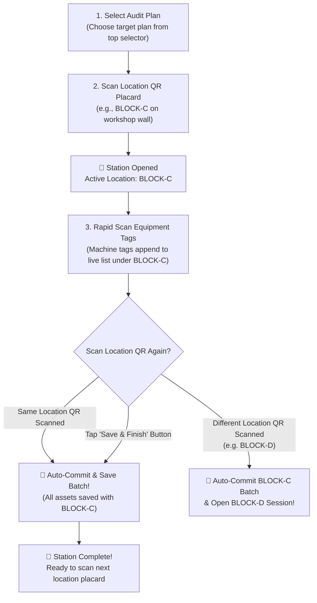

# 📋 Floor Walk Audit Workflow Guide

This document describes the physical floor walk auditing workflow implemented in the Assets Management & Auditing System (`/scan` and `/audits`).

---

## 🎯 Overview

The floor walk audit workflow is designed for high-speed, frictionless physical verification on mobile devices and handheld barcode scanners. Auditors walk through factory workshops, plants, and facility sections using an intuitive **Location-Bound Batching** process:



---

## 📱 Detailed Step-by-Step Process

### Step 1: Select Audit Plan
1. Open the scanner at **`http://localhost:3000/scan`** (or click **"Launch Scanner"** from any plan on `/audits`).
2. At the top of the screen, select the active **Audit Plan** from the dropdown (e.g. *"Q4 BLOCK-C Physical Machinery Verification"*).
3. The scanner initializes into **Floor Walk Audit Mode**.

---

### Step 2: Scan Location QR Placard
1. The scanner displays:
   > **`📍 Step 1: Scan Location QR Placard`**  
   > *Point camera at the station or room placard (e.g., BLOCK-C) to open this location session.*
2. The auditor points the camera at the physical QR placard on the station wall or workshop door (e.g., `BLOCK-C`).
3. An audio chime rings, and the location session activates:
   > **`📍 Active Station: BLOCK-C (Station)`**  
   > *Now scan equipment tags in this station. When finished, scan BLOCK-C again to save.*

---

### Step 3: Scan Equipment Tags (Live Station List)
1. The camera remains open for continuous, rapid scanning.
2. Every scanned equipment tag immediately appends to the live list right below the camera:
   - **Sequence ID**: `[#1]`, `[#2]`, etc.
   - **Tag & SAP Codes**: `AST-00101` (SAP: `SAP-EQ-90412`).
   - **Equipment Name**: e.g. *5-Axis CNC Milling Center*.
   - **Physical Condition Pills**: Default is `GOOD`. Tap `Fair` or `Damaged` with 1 touch to record wear or defects.
   - **Relocation Detection**:
     - If the asset was expected in this room: shows **`✅ Station verified`**.
     - If the asset belonged to another room (e.g. `BLOCK-A`): automatically flags in orange:  
       **`⚠️ Relocated: Expected at BLOCK-A`**.
   - **Remove Button**: `(X)` to remove an accidental scan before committing.

---

### Step 4: Scan Location Again &rarr; Auto-Save Batch!
1. Once all assets in the station have been scanned, the auditor simply points the camera at the **`BLOCK-C`** location QR placard a second time.
   *(Alternatively, tap the large button: **`[💾 Save & Finish BLOCK-C (X Assets)]`**).*
2. The system detects the location code and commits the entire batch to the backend database:
   - Persists all scanned assets under the `BLOCK-C` session.
   - Records physical conditions (`GOOD`, `FAIR`, `DAMAGED`).
   - Auto-generates discrepancy records for damaged machinery or relocated equipment (`LOCATION_MISMATCH`).
3. A two-tone celebration chime plays and displays:
   > **`🎉 Successfully saved X equipment tags at BLOCK-C!`**
4. The list clears and the scanner resets to **Step 2**, ready to scan the next room's placard.

> **Moving Directly to Another Room?**  
> If an auditor walks directly into `BLOCK-D` and scans `BLOCK-D` without rescanning `BLOCK-C`, the system automatically commits the `BLOCK-C` batch first and immediately opens `BLOCK-D`!

---

### Step 5: Mark Session Complete & Scanning Lock
When physical verification for a session or station is finished, users can mark the session as complete:

1. **Directly from the Scanner (`/scan`)**:
   - Right after saving a station batch, the celebration banner provides a one-click button:  
     **`[✓ Mark Complete]`**.
   - Instantly marks the station session as `COMPLETED`.

2. **From the Audit Plan Dashboard (`/audits/[id]`)**:
   - Each session card displays an explicit **`[✓ Mark Complete]`** button next to its status badge.
   - The checklist header also includes a **`[✓ Mark Complete]`** button for the selected session.
   - **Session Inventory Checklist**: Displays full reconciliation details across all scoped assets:
     - **Asset Code & Name**: e.g., `ABL-100000000000` (*Land*).
     - **Expected Location**: Registered location in system records (e.g., `ABL`).
     - **Physical Location**: Actual station location where the equipment was physically scanned (e.g., `BLOCK-C`), with an automatic **`⚠️ Relocated`** indicator if different from expected.
     - **Audit Status & Condition**: Verification status (`VERIFIED`, `MISMATCH`, `DAMAGED`, `MISSING`, `PENDING`) and physical condition assessment.
     - **Pagination & Search Filtering**: Built-in client pagination (5, 10, 25, 50 assets per page) with quick text search (asset code, name, location) and status dropdown filters (`VERIFIED`, `MISMATCH`, `DAMAGED`, etc.).
   - **Plan Auto-Completion**: When all sessions under an audit plan are marked complete, the audit plan's overall status automatically updates to **`COMPLETED`**.

3. **🔒 Scanning Locked Upon Completion**:
   - Once a session is marked `COMPLETED`:
     - **Disabled in Plan Dashboard**: The "Scanner" button on the session card, the "Scan in Session" header button, and individual asset scan buttons are disabled with a `[🔒 Locked]` badge.
     - **Disabled in Scanner Viewfinder**: The camera viewfinder stops, the camera trigger is disabled, and a dedicated **Station Session Completed (Locked)** card is presented.
     - **Disabled in Handheld Scanner / Manual Input**: The input field and verify button are locked (`disabled`).
     - **Station Placard Scan Blocked**: If an auditor attempts to scan a location placard whose session under this plan is already `COMPLETED`, the system rings a warning chime and displays `🔒 Station [Location Name] is already marked COMPLETED for this audit plan. Scanning is locked.`
     - **Backend API Protection**: `submitAuditItem` and `commitLocationBatch` automatically reject scans with `400 Bad Request` if the target session is already completed.

4. **Reopen Capability**:
   - If an auditor needs to verify additional assets or correct a scan, clicking **`[↺ Reopen Session]`** (on `/scan` or on `/audits/[id]`) immediately sets the session back to `IN_PROGRESS` and re-enables all camera and scanning features.

---

## 📡 API Specification

### Endpoint: Commit Location Batch

```http
POST /api/v1/audits/plans/:planId/commit-location
Content-Type: application/json
```

#### Request Payload:
```json
{
  "locationId": "cmvxodp9z000crjmgsc83i5zz",
  "auditorId": "admin",
  "items": [
    {
      "assetId": "cmvxkgl6b0000rj0lf78icx61",
      "condition": "GOOD"
    },
    {
      "assetId": "cmvxm3a1z0001rj0l4gh82b12",
      "condition": "DAMAGED"
    }
  ]
}
```

#### Response:
```json
{
  "success": true,
  "data": {
    "success": true,
    "sessionId": "cmvy58x0r0003rjjqfbjg30ic",
    "location": {
      "id": "cmvxodp9z000crjmgsc83i5zz",
      "name": "BLOCK-C",
      "code": "BLOCK-C"
    },
    "committedCount": 2,
    "discrepanciesCount": 1
  },
  "timestamp": "2026-11-01T18:34:55.377Z"
}
```

### Endpoint: Mark Session Complete / Reopen

```http
PUT /api/v1/audits/sessions/:sessionId/complete
PUT /api/v1/audits/sessions/:sessionId/reopen
```

Sets session status to `COMPLETED` (or reopens to `IN_PROGRESS`) and checks whether all sessions under the parent audit plan are completed.

---

### Endpoint: Audit Status Report & Excel Export

```http
GET /api/v1/reports/audits?planId=:id&status=:status
GET /api/v1/reports/audits/export?planId=:id&status=:status
```

Returns consolidated or plan-scoped audit status metrics, station compliance rate, relocation mismatches, and streams a formatted multi-sheet Excel report (`audit-status-report.xlsx`).

---

## 📊 Step 6: Audit Status & Compliance Reporting (`/reports`)

Auditors and managers can review, filter, and export audit reconciliation status from the **Reports Hub** (`/reports`):

1. **Executive KPI Overview**:
   - **Station Compliance Rate (%)**: Verified assets as a percentage of total scoped equipment.
   - **Station Verified**: Count of machinery confirmed at their registered stations.
   - **Relocated (Location Mismatch)**: Count of machinery physically discovered in a different room/building.
   - **Damaged & Defect Count**: Machinery marked with physical defects during floor walks.
   - **Missing Equipment Count**: Unscanned assets remaining unaccounted for.
   - **Discrepancy Resolution Progress**: Tracked anomalies (`LOCATION_MISMATCH`, `DAMAGED`) and their resolution rates.

2. **Visual Reconciliation Bar**:
   - Stacked horizontal distribution bar showing proportional percentages of Verified, Relocated, Damaged, Missing, and Pending items.

3. **Multi-Sheet Excel Export (`.xlsx`)**:
   - Sheet 1: **Executive Summary** containing high-level compliance rates, condition metrics, and discrepancy totals.
   - Sheet 2: **Reconciliation Checklist** with complete line-by-line inventory records (Asset Code, SAP Code, Expected vs Physical Location, Relocation alerts, Condition, Auditor, and Scanned Timestamp).

4. **Interactive Filters**:
   - Filter by specific **Audit Plan** (or Consolidated All Plans).
   - Filter by **Audit Status** (`VERIFIED`, `MISMATCH`, `DAMAGED`, `MISSING`, `PENDING`).
   - Filter by **Condition** (`GOOD`, `FAIR`, `DAMAGED`).
   - Real-time text search across asset codes, SAP numbers, station names, and auditor identities.

---

## 🔊 Audio Feedback Guide

| Sound | Frequencies | Trigger |
|-------|-------------|---------|
| **Asset Chime** | `880 Hz` | Equipment tag scanned and added to the live list |
| **Location Chime** | `587 Hz &rarr; 880 Hz` | Location QR scanned and station session opened |
| **Saved Chime** | `523 Hz &rarr; 659 Hz &rarr; 784 Hz` | Batch committed and saved with location |
| **Warning Chime** | `440 Hz &rarr; 330 Hz` | Asset scanned before location placard, or duplicate scan |

