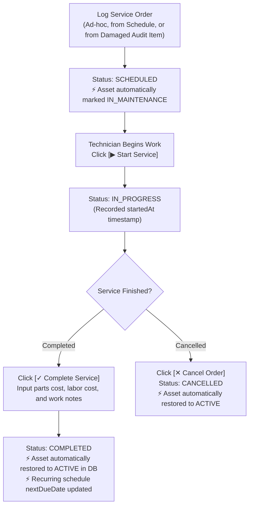

# 🔧 Equipment Maintenance & Servicing Workflow Guide

This document describes the maintenance lifecycle implemented in the Assets Management & Auditing System (`/maintenance`, `/assets`, and `/audits`).

---

## 🎯 Overview

The Maintenance & Servicing Module allows plant managers, technicians, and reliability engineers to manage equipment upkeep through two primary pathways:
1. **Service Work Orders**: Ad-hoc or breakdown work orders (`PREVENTIVE`, `CORRECTIVE`, `INSPECTION`).
2. **Preventive Schedules**: Recurring cycle rules (e.g. every 30, 90, 180, or 365 days) that automatically schedule periodic service.

---

## 🚦 Work Order Lifecycle & Database Side-Effects

| State | Badge | Description | Database Side-Effects |
| :--- | :--- | :--- | :--- |
| **`SCHEDULED`** | 🟡 Yellow | Work order created and queued. | `Asset.status = 'IN_MAINTENANCE'` |
| **`IN_PROGRESS`** | 🔵 Blue (Pulse) | Technician has begun physical work. | `startedAt = now()`, `Asset.status = 'IN_MAINTENANCE'` |
| **`COMPLETED`** | 🟢 Green | Repairs/upkeep finished and inspected. | `completedAt = now()`, parts & labor costs recorded, **`Asset.status = 'ACTIVE'`** |
| **`CANCELLED`** | ⚪ Gray | Work order aborted. | `Asset.status = 'ACTIVE'` |

---

## 📱 Entry Points to Maintenance

1. **Maintenance Hub (`/maintenance`)**:
   - Access from sidebar: KPI statistics, live work orders, and recurring preventive schedules.
   - Click **`+ Log Service Order`** or **`+ Preventive Schedule`** with live asset autocomplete.
2. **Asset Details (`/assets/[id]`)**:
   - Click the amber **`[Maintenance]`** button in the header action bar to immediately log service for that specific machine.
3. **Audit Discrepancy Findings (`/audits/[id]`)**:
   - When an asset's condition during a floor walk is flagged as **`DAMAGED`** or **`POOR`**, an amber **`[Repair]`** button appears in the audit checklist table, routing directly to log corrective service.
4. **Trigger from Preventive Schedule**:
   - In `/maintenance` under the *Recurring Schedules* tab, click **`[Trigger Order]`** to spawn a fresh service work order from that recurring cycle.

---

## 📡 REST API Reference

Exposed under `/api/v1/maintenance` (and proxied via `/api/maintenance`):

- `GET /api/v1/maintenance/stats`: Real-time KPI summary (total, scheduled, in-progress, completed, cancelled, total spent, active schedules).
- `GET /api/v1/maintenance/records`: List service orders (filters: `status`, `type`, `assetId`, `vendorId`).
- `POST /api/v1/maintenance/records`: Create service order.
- `GET /api/v1/maintenance/records/:id`: Fetch work order details.
- `PATCH /api/v1/maintenance/records/:id/start`: Begin service (`IN_PROGRESS`).
- `PATCH /api/v1/maintenance/records/:id/complete`: Finish service (`COMPLETED`, updates cost and restores asset to `ACTIVE`).
- `PATCH /api/v1/maintenance/records/:id/cancel`: Cancel service (restores asset to `ACTIVE`).
- `GET /api/v1/maintenance/schedules`: List recurring schedules.
- `POST /api/v1/maintenance/schedules`: Create new preventive schedule rule.

