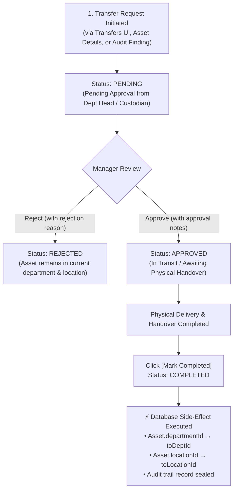

# 🔄 Asset Transfer & Relocation Workflow Guide

This document describes the end-to-end asset transfer and relocation lifecycle implemented in the Assets Management & Auditing System (`/transfers`, `/assets`, and `/audits`).

---

## 🎯 Overview

The Asset Transfer Workflow governs equipment movement between organizational departments (e.g. from *Production* to *Maintenance*) and physical facility locations (e.g. from *BLOCK-A* to *BLOCK-C*). 

It enforces approval governance, maintains an immutable custody history, and executes automated database state mutations upon delivery.



---

## 📱 Entry Points to Initiate a Transfer

The system provides 4 friction-free entry points to initiate an asset transfer:

### 1. Dedicated Transfers Dashboard (`/transfers`)
- Click **`+ Initiate Transfer`** at the top right of `/transfers`.
- Live autocomplete search by Asset Code, SAP Code, or Equipment Name.
- Select target **Department** and/or target physical **Station/Location**.
- Enter transfer reason and submit.

### 2. Assets Inventory List (`/assets`)
- In the table row actions next to the QR code and details button, click the **Transfer (`<ArrowLeftRight />`)** icon.
- Automatically opens `/transfers` with the selected asset prefilled.

### 3. Asset Details Page (`/assets/[id]`)
- In the top action bar next to *Print Tag* and *Verify / Audit*, click **`[Transfer Asset]`**.
- Automatically routes to `/transfers?assetId=...&code=...` with full asset context preloaded.

### 4. Audit Discrepancy 1-Click Resolution (`/audits/[id]`)
- When physical floor walks identify relocated equipment (status: **`MISMATCH`**), a highlighted **`[Transfer]`** button appears in the Session Inventory Checklist action column.
- Clicking the button opens `/transfers` with both the **Asset Code** and discovered **Physical Location** (`toLocationId`) prefilled for immediate regularization.

---

## 🚦 Transfer Lifecycle Stages

| State | Badge | Description | Permitted Actions |
| :--- | :--- | :--- | :--- |
| **`PENDING`** | 🟡 Yellow / Warning | Request has been submitted by staff and is awaiting review. | **Approve** (transitions to `APPROVED`)<br/>**Reject** (transitions to `REJECTED`) |
| **`APPROVED`** | 🔵 Blue / In Transit | Transfer approved by department manager. Asset is authorized for transit. | **Complete** (transitions to `COMPLETED`) |
| **`COMPLETED`** | 🟢 Green / Success | Asset has been physically received and confirmed at destination. | Read-only. Database state mutations applied. |
| **`REJECTED`** | 🔴 Red / Destructive | Transfer request declined by reviewer. | Read-only. Reason recorded in notes. |

---

## ⚡ Automated Database State Mutations

When an authorized user clicks **`[Mark Completed]`**:

1. A Prisma atomic transaction runs against MSSQL:
   ```typescript
   await prisma.$transaction(async (tx) => {
     // 1. Seal transfer status
     await tx.assetTransfer.update({
       where: { id },
       data: { status: 'COMPLETED' },
     });

     // 2. Mutate Asset Master Record
     const updateData: any = {};
     if (transfer.toDeptId) updateData.departmentId = transfer.toDeptId;
     if (parsedToLocationId) updateData.locationId = parsedToLocationId;

     if (Object.keys(updateData).length > 0) {
       await tx.asset.update({
         where: { id: transfer.assetId },
         data: updateData,
       });
     }
   });
   ```
2. The asset's current department and physical station are updated synchronously.
3. Subsequent audit floor walks immediately reflect the new expected location, clearing mismatch alerts.

---

## 📡 REST API Reference

All transfer endpoints are exposed under `/api/v1/transfers` (and reverse-proxied by Next.js under `/api/transfers`):

### 1. Get KPI Statistics
- **Method**: `GET /api/v1/transfers/stats`
- **Response**:
  ```json
  {
    "total": 12,
    "pending": 3,
    "approved": 2,
    "completed": 6,
    "rejected": 1
  }
  ```

### 2. List Transfers
- **Method**: `GET /api/v1/transfers`
- **Query Parameters**:
  - `status`: Filter by `PENDING`, `APPROVED`, `COMPLETED`, `REJECTED`, or omit for all.
  - `departmentId`: Filter transfers targeting or originating from a specific department.
  - `assetId`: Filter transfers for a specific asset.
- **Includes**: Asset details, category, location, source & destination departments, requesting user, and approving user.

### 3. Initiate Transfer Request
- **Method**: `POST /api/v1/transfers`
- **Payload**:
  ```json
  {
    "assetId": "cmvxkhcff0actrj0lhck3aihd",
    "toDeptId": "cmvyqv6bh0000rjkd4tlbgsz6",
    "toLocationId": "cmvxkf1o401btrj0lg20z9cqa",
    "reason": "Relocating from Block A to Block C for Q4 maintenance."
  }
  ```

### 4. Approve Transfer
- **Method**: `PATCH /api/v1/transfers/:id/approve`
- **Payload**:
  ```json
  {
    "approvalNotes": "Approved for transit by Production Head."
  }
  ```

### 5. Reject Transfer
- **Method**: `PATCH /api/v1/transfers/:id/reject`
- **Payload**:
  ```json
  {
    "rejectionNotes": "Machine is required for active production order until end of week."
  }
  ```

### 6. Complete Transfer
- **Method**: `PATCH /api/v1/transfers/:id/complete`
- **Payload**: `{}`
- **Effect**: Status set to `COMPLETED`, Asset record updated in MSSQL.

