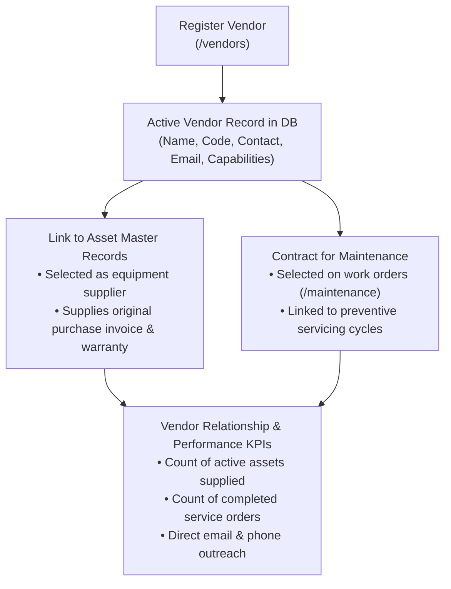

# 🏢 Vendor & Supplier Management Guide

This document describes the Vendor & Supplier management lifecycle implemented in the Assets Management & Auditing System (`/vendors`, `/assets`, and `/maintenance`).

---

## 🎯 Overview

The Vendors module centralizes external partner relations for:
1. **OEM Equipment Manufacturers**: Sourcing, capitalization, original purchase invoice records, and warranty coverage.
2. **Spare Parts Distributors**: Sourcing replacement components, tooling, and lubrication consumables.
3. **Third-Party Maintenance Contractors**: External service engineering, electrical automation, calibration, and statutory inspection partners.

---

## 📱 Capabilities & Features

### 1. Dedicated Vendor Directory (`/vendors`)
- Accessible directly from the sidebar navigation.
- **KPI Summary Cards**:
  - Total Registered Vendors
  - Active Partners (eligible for orders and AMC contracts)
  - Inactive / Archived
  - Total Supplied Assets across factory inventory
  - Contracted Service Work Orders
- **Search & Filters**:
  - Instant text filter by Vendor Name, Vendor Code (`VND-001`), Contact Person, Email, Phone, or Capabilities.
  - Status toggle (`All`, `Active Only`, `Inactive Only`).
- **Direct Communication Links**:
  - Clickable `mailto:` links to email vendors directly.
  - Clickable `tel:` links to call key account managers.
  - External links (`<ExternalLink />`) to visit official vendor websites.
- **Inventory Linkage**:
  - Click the **Supplied Assets count** to jump to `/assets` filtered by equipment supplied by this vendor.
- **Actions**:
  - `[Edit]` button with prefilled vendor profile modal.
  - `[Activate / Deactivate]` toggle to control vendor eligibility.

### 2. Integration with Equipment Assets (`/assets`)
- Vendors registered in `/vendors` automatically populate the Vendor selector in:
  - Asset Registration (`/assets/new`)
  - Asset Edit Modal & Full-Page Edit (`/assets/[id]/edit`)
- Linking an asset to a vendor updates the vendor's supplied assets count in real-time.

### 3. Integration with Maintenance (`/maintenance`)
- Vendors can be selected as the service contractor on corrective repair orders and preventive maintenance schedules.

---

## 📡 REST API Reference

Exposed under `/api/v1/vendors` (and proxied via `/api/vendors`):

- `GET /api/v1/vendors/stats`: Returns KPI totals (`total`, `active`, `inactive`, `totalAssetsSupplied`, `totalServiceOrders`).
- `GET /api/v1/vendors`: List vendors (paginated, with search and active status filters). Includes `_count` of linked assets and maintenance records.
- `POST /api/v1/vendors`: Register new vendor.
- `GET /api/v1/vendors/:id`: Fetch vendor details including recent supplied assets and service records.
- `PUT /api/v1/vendors/:id` & `PATCH /api/v1/vendors/:id`: Update vendor profile or toggle active status.
- `DELETE /api/v1/vendors/:id`: Soft-delete (deactivate) vendor.

