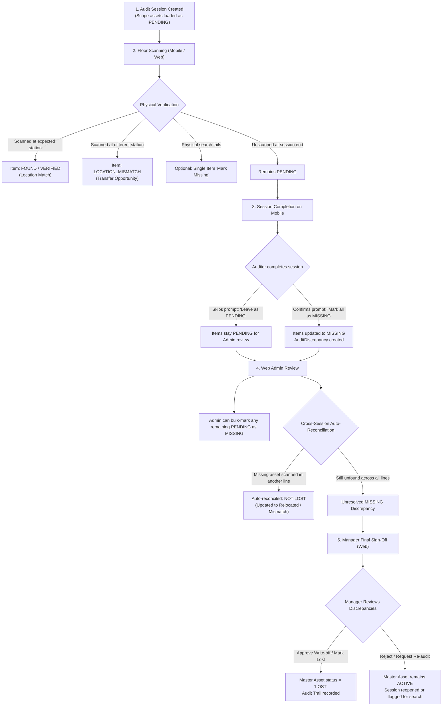

# Missing Assets Management & Reconciliation Workflow

## Executive Summary
This document outlines the end-to-end lifecycle and business rules for identifying, tracking, reconciling, and approving **MISSING** assets in the **Crystal Martin Asset Management & Auditing System**.

The workflow is designed to prevent premature asset write-offs while ensuring accountability across both the **Mobile Terminal** (factory floor) and the **Web Admin Portal** (management oversight).

---

## High-Level Architecture & Lifecycle

---

## Detailed Stages & Business Rules

### Stage 1: Pre-Populating & Live Floor Scanning
1. **Initial State (`PENDING`)**:
   - When an `AuditSession` is initialized for a station, line, or block, all expected assets are generated with `AuditItem.status = 'PENDING'`.
   - The master `Asset.status` remains unchanged (e.g. `ACTIVE` or `ASSIGNED`).
2. **Floor Actions (Mobile)**:
   - **Barcode / QR Scan**: Instantly sets item to `FOUND` (if location matches) or `LOCATION_MISMATCH` (if scanned outside its registered location).
   - **Single Item Mark Missing**: An auditor who thoroughly searches a rack and verifies the asset is absent can tap **"Mark Missing"** on that individual item row.

---

### Stage 2: Session Completion (Auditor Level — Option A)
When an auditor finishes scanning a line and taps **"Complete Session"**:
1. **Unscanned Check**:
   - The system checks if there are any items remaining with `status = 'PENDING'`.
2. **Confirmation Prompt**:
   - If `unscannedCount > 0`, the mobile app presents an action sheet / alert:
     > **Session Completion Notice**  
     > *There are X expected assets that were not scanned in this session.*  
     > - **Option 1: [Mark All Remaining as MISSING]**  
     >   *(Sets remaining items to MISSING and logs discrepancy records)*  
     > - **Option 2: [Complete & Leave as PENDING]**  
     >   *(Leaves items as PENDING for Web Admin investigation)*  
     > - **Option 3: [Cancel & Keep Scanning]**  
3. **Audit Discrepancy Generation**:
   - For every item marked `MISSING`, an `AuditDiscrepancy` record (`discrepancyType: 'MISSING'`) is created and tied to the session.

---

### Stage 3: Web Admin Floor Management (Option C)
If an auditor skips marking unscanned items as missing, or if an audit was performed ad-hoc:
1. **Unscanned Tracking on Web**:
   - In `apps/web/src/app/audits/[id]/page.tsx`, the Session Details tab displays the exact breakdown: `VERIFIED`, `MISMATCH`, `MISSING`, `DAMAGED`, and `PENDING`.
2. **Bulk Action for Admin**:
   - Web Admins have a button: **"Mark Unscanned as MISSING"**:
     - Can be run per session or across the entire audit plan.
     - Transitions all `PENDING` records to `MISSING` in bulk.
     - Creates corresponding `AuditDiscrepancy` records.
3. **Single Row Override**:
   - Admins can toggle individual item statuses directly in the item list.

---

### Stage 4: Cross-Session Smart Reconciliation (Zero False Positives)
In enterprise factory operations, machines frequently move between lines without formal paperwork.
1. **Scenario**:
   - Asset `ABL-602000001308` is expected at Line 01.
   - Line 01 audit finishes at 10:00 AM; asset was not found and was marked `MISSING`.
   - Line 04 audit begins at 2:00 PM; auditor scans `ABL-602000001308` physically located at Line 04.
2. **System Behavior**:
   - The system detects that `ABL-602000001308` has an open `MISSING` item in Line 01 under the same audit plan.
   - **Auto-Reconciliation Trigger**:
     - Line 01's item status is updated from `MISSING` to `RELOCATED / RESOLVED`.
     - The discrepancy is marked resolved: *"Found at Line 04 during Session #XYZ"*.
     - Line 04 logs a `LOCATION_MISMATCH` with an option to finalize an internal asset transfer.
   - **Result**: The asset is **not** written off as lost.

---

### Stage 5: Manager Final Approval & Master Registry Update (Q3 Rule)
> [!IMPORTANT]
> **Safety Rule**: Marking an audit item as `MISSING` in a session does **NOT** alter the master `Asset.status` in the primary enterprise catalog.

1. **Manager Review Portal (Web)**:
   - When all sessions in an `AuditPlan` are complete, the plan status moves to `REVIEW` (or `COMPLETED`).
   - The Audit Discrepancies table lists all confirmed `MISSING` items that were **never found anywhere** during the audit.
2. **Approval Action**:
   - A Manager (with `ADMIN` or `MANAGER` role) reviews the list and clicks **"Approve Missing / Write-off"**:
     - System prompts for formal notes (e.g., incident reference, police report, or write-off code).
     - Updates master `Asset.status = 'LOST'`.
     - Logs an entry in `AssetStatusHistory` (`oldStatus = 'ACTIVE'`, `newStatus = 'LOST'`, `changedById`, `reason`).
     - Updates `AuditDiscrepancy.resolvedAt` and `resolvedById`.
3. **Rejection / Re-Check Action**:
   - If the manager believes the asset is still on-site, they can click **"Request Floor Search"** or **"Reopen Line"**:
     - Master `Asset.status` remains `ACTIVE`.
     - Discrepancy remains open with priority flag for security/floor supervisor inspection.

---

## Database State Matrix

| Stage | `AuditItem.status` | `AuditDiscrepancy` | Master `Asset.status` | Triggered By |
| :--- | :--- | :--- | :--- | :--- |
| **Session Start** | `PENDING` | None | `ACTIVE` | System auto-generate |
| **Physical Scan Match** | `FOUND` / `VERIFIED` | None | `ACTIVE` | Auditor scan |
| **Physical Scan Wrong Station** | `LOCATION_MISMATCH` | Created (`LOCATION_MISMATCH`) | `ACTIVE` | Auditor scan |
| **Floor Session Completion** | `MISSING` *(if chosen)* or `PENDING` | Created (`MISSING`) | `ACTIVE` (Unchanged) | Auditor tap "Complete Session" |
| **Admin Web Review** | `MISSING` | Created (`MISSING`) | `ACTIVE` (Unchanged) | Admin "Mark Unscanned as MISSING" |
| **Cross-Line Found** | `RELOCATED` / `VERIFIED` | Resolved auto | `ACTIVE` | Auto-reconciliation |
| **Manager Final Approval** | `MISSING` (Finalized) | Resolved (`resolvedAt`) | **`LOST`** | Manager approve write-off on Web |

---

## Next Steps for Implementation
1. **API Endpoints**:
   - `PUT /audits/sessions/:id/complete`: Support `{ markUnscannedAsMissing: boolean }`.
   - `PUT /audits/sessions/:id/mark-unscanned-missing`: Dedicated endpoint to mark remaining `PENDING` as `MISSING`.
   - `PUT /audits/plans/:id/approve-missing`: Endpoint for Manager to approve unresolved missing discrepancies and transition master `Asset.status -> 'LOST'`.
2. **Mobile App**:
   - In `SessionInventoryScreen.tsx`: Add confirmation alert on "Complete Session" to offer "Mark Remaining as MISSING" vs "Leave as PENDING".
   - Add single item "Mark Missing" action button on `PENDING` items.
3. **Web Portal**:
   - In `/audits/[id]/page.tsx`: Add "Mark Unscanned as MISSING" button for sessions.
   - Add "Approve & Mark Lost in Master" button in Discrepancies tab for Managers.

